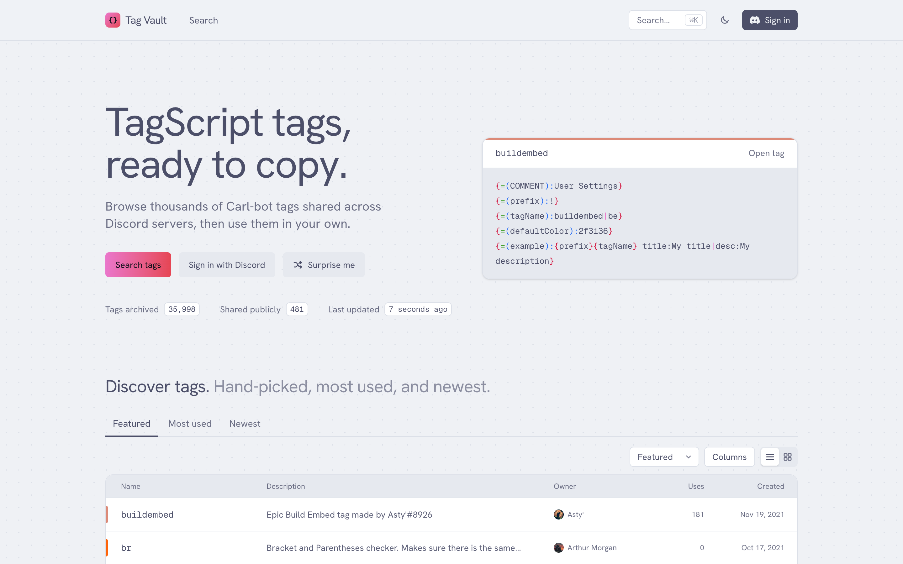
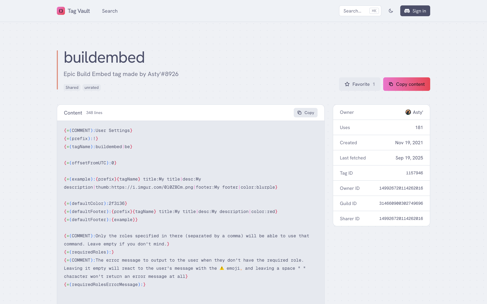

# tag-vault

[](https://app.netlify.com/projects/tagvault/deploys)

This is not affiliated or endorsed by BotLabs, Carl-bots parent company.

<picture>
  <source media="(prefers-color-scheme: dark)" srcset="docs/screenshots/home-dark.png" />
  
</picture>

<picture>
  <source media="(prefers-color-scheme: dark)" srcset="docs/screenshots/tag-dark.png" />
  
</picture>

## Demo

[](https://youtu.be/P9jHRgsxCpU)

## Running the project

You'll need [Bun](https://bun.sh/) installed. Then do the following:

```sh
git clone https://github.com/Leg3ndary/tag-vault.git

cd tag-vault

bun install
bun dev
```

Copy `.env.example` to `.env.local` and fill it in. See [docs/environment.md](docs/environment.md) for what each variable does.

## Project layout

The app lives in `src/` (Next.js App Router), shared code in `packages/`, maintenance scripts in `scripts/` and documentation in `docs/`. See [docs/architecture.md](docs/architecture.md) and [docs/data-model.md](docs/data-model.md).

| Command              | Purpose                                  |
| -------------------- | ---------------------------------------- |
| `bun dev`            | Start the dev server                     |
| `bun run build`      | Production build                         |
| `bun run lint`       | ESLint                                   |
| `bun run typecheck`  | TypeScript                               |
| `bun run format`     | Prettier                                 |
| `bun run db:indexes` | Create the MongoDB indexes TagVault uses |

Note this won't work unless you have a MongoDB database with all the tags inside, however I'll probably add fake datasets later so people can actually run the project locally.

## Demo video

The demo is a [Remotion](https://www.remotion.dev/) project in `packages/video`. Scene timing and narration lines live in `packages/video/src/script.ts`. Run these from `packages/video`:

| Command             | Purpose                                                              |
| ------------------- | -------------------------------------------------------------------- |
| `bun run studio`    | Preview the video in Remotion Studio                                 |
| `bun run narration` | Generate the voiceover with ElevenLabs and time each line to a scene |
| `bun run audio`     | Fit each narration line into its scene window                        |
| `bun run render`    | Render `out/tagvault-demo.mp4`                                       |

`bun run narration` needs `ELEVENLABS_API_KEY` in `packages/video/.env`.
